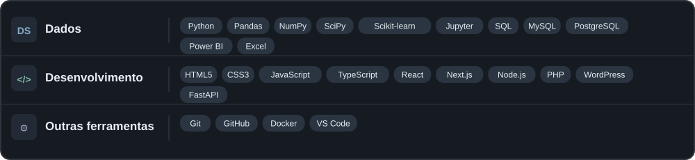
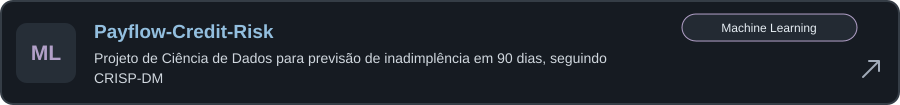
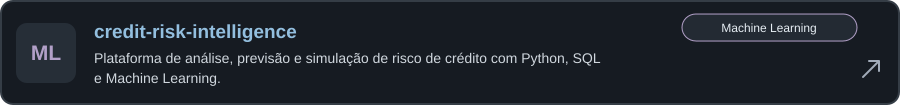
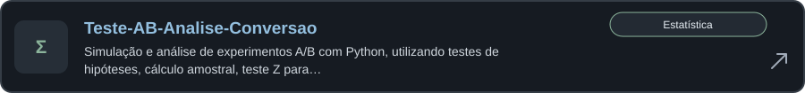
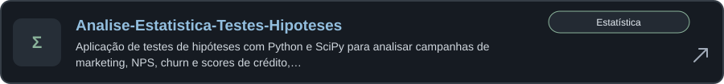
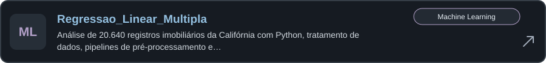

# Caique Vilhegas

### ◇ Sobre mim

> Sou formado em **Ciência da Computação** e atualmente curso a pós-graduação em **AI Scientist na FIAP**, aprofundando meus conhecimentos em **Data Science, Machine Learning e Inteligência Artificial**. Tenho também formação técnica em **Mecatrônica** pela Etec Getúlio Vargas e sou certificado **CPA pela ANBIMA**.
>

### ◈ Tecnologias e ferramentas

### ☆ Projetos em destaque

Principais projetos do meu portfólio, selecionados pela profundidade técnica e aplicação prática.

<!-- FEATURED:START -->

<!-- FEATURED:END -->

---

### ◷ Projetos mais recentes

Três projetos públicos recentes, atualizados automaticamente.

<!-- PROJECTS:START -->

<!-- PROJECTS:END -->

---

São Paulo, Brasil · Ciência de Dados &amp; Machine Learning

